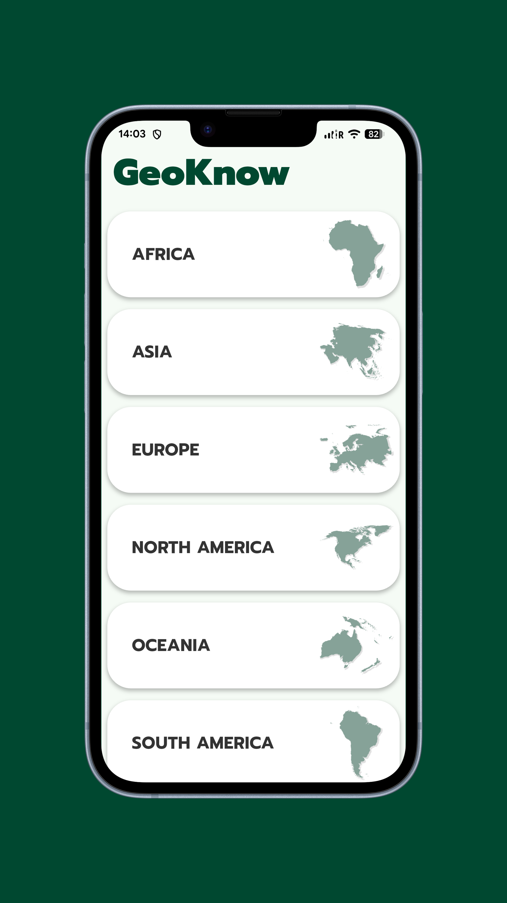
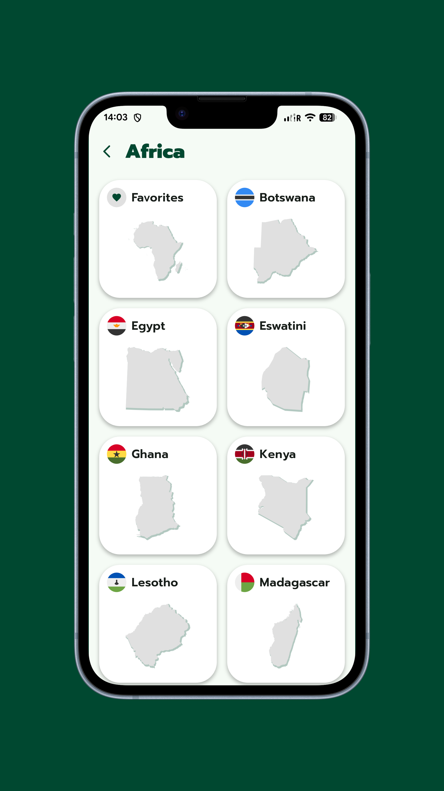
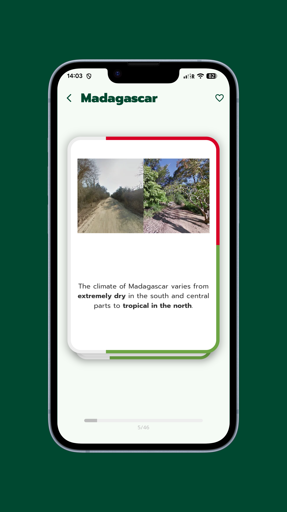
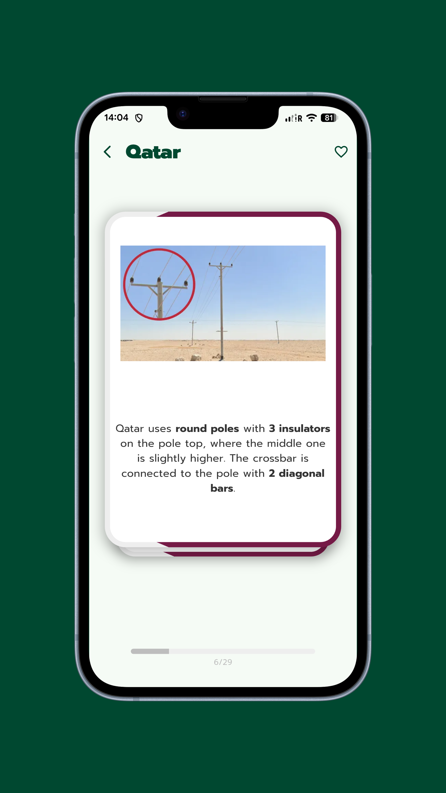
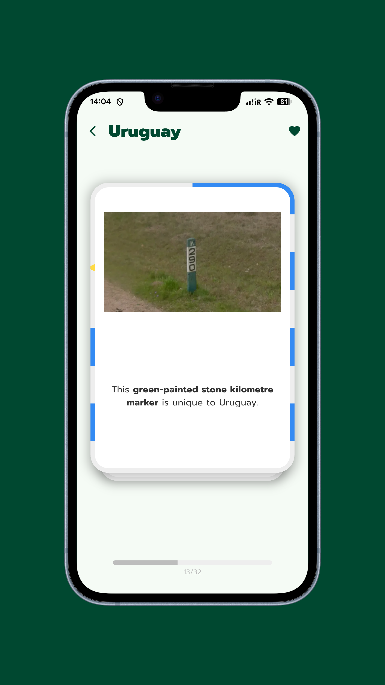

# GeoKnow

GeoKnow is a Flutter-based mobile application designed to help players improve their **GeoGuessr** skills through interactive flashcards and quizzes. Whether you are a beginner or a seasoned pro, GeoKnow provides the tools to master geographical locations, flags, outlines, bollards, and more.

## 📱 Features

-   **Flashcards**: Use swipable flashcards to study different regions and their unique characteristics.
-   **Quizzes**: Test your knowledge with various quiz modes, including a dedicated **Bollard Quiz**.
-   **Comprehensive Database**: Detailed information organized by continents, countries, and territories.
-   **Visual Learning**: High-quality country outlines, flags, and state-specific details.
-   **Favorites**: Save difficult cards or regions to review them later for targeted practice.
-   **Offline Support**: Core data and assets are bundled for efficient performance.

## 📸 Screenshots

|              Home               |                  Country                  |                 Madagascar                  |              Qatar              |                Uruguay                |
|:-------------------------------:|:-----------------------------------------:|:-------------------------------------------:|:-------------------------------:|:-------------------------------------:|
|  |  |  |  |  |

## ☕ Support

If you find this project helpful and want to support its development, you can buy me a coffee!

<a href="https://buymeacoffee.com/bigbenyayi">
  
</a>

## 🛠 Tech Stack

-   **Framework**: [Flutter](https://flutter.dev/)
-   **State Management**: None
-   **Backend/Monitoring**: [Firebase](https://firebase.google.com/) (Core, Crashlytics)
-   **Key Packages**:
    -   `flutter_card_swiper`: For the interactive flashcard experience.
    -   `cached_network_image` & `octo_image`: Efficient image loading and placeholders.
    -   `flutter_svg`: Rendering vector graphics for flags and outlines.
    -   `shared_preferences`: Local storage for favorites.
    -   `confetti`: Celebration effects for quiz completions.

## 🚀 Getting Started

### Prerequisites

-   Flutter SDK: `^3.0.5`
-   Android Studio / VS Code
-   Firebase project setup (for Crashlytics)

### Installation

1.  **Clone the repository**:
    ```bash
    git clone https://github.com/your-username/geo-know.git
    cd geo-know
    ```

2.  **Install dependencies**:
    ```bash
    flutter pub get
    ```

3.  **Run the app**:
    ```bash
    flutter run
    ```

## 📂 Project Structure

-   `lib/screen/`: UI screens for quizzes, lists, and favorites.
-   `lib/model/`: Data models for countries, continents, and quizzes.
-   `lib/presentation/`: Reusable UI components and widgets.
-   `lib/values/`: Enums and static data for geographical entities.
-   `assets/data/`: JSON files containing extensive geographical and quiz data.
-   `assets/images/`: Assets including flags, outlines, and UI icons.

---

Made with ❤️ for the GeoGuessr community.
